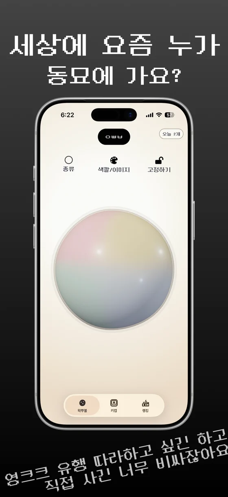
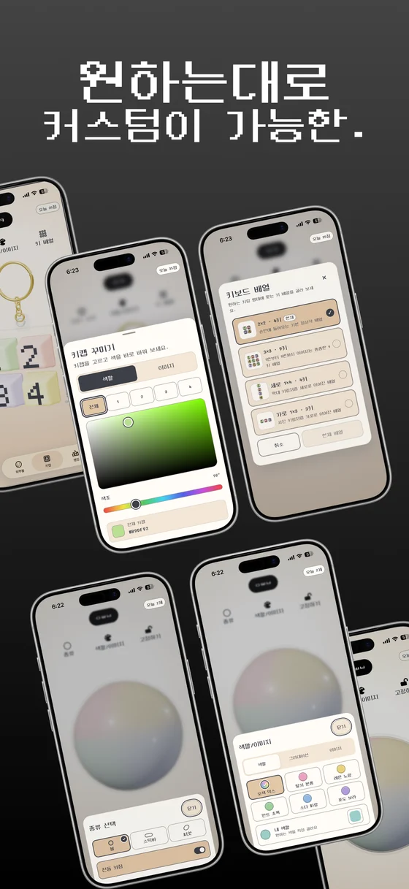

# 김재우 · Dev.peon

웹과 모바일 제품을 만들고 운영하는 풀스택 개발자입니다. 커머스와 교육 서비스에서 사용자 화면과 운영 도구를 개발했습니다.

## 프로젝트

### 누잼

왁뿌볼을 누르거나 키보드 키링을 두드리며 잠깐 쉴 수 있는 감각 놀이 앱입니다.

**담당** · 기획, 디자인, 개발, 운영

[누잼 소개](https://www.nuzam.kr/) · [App Store](https://apps.apple.com/kr/app/id6797218260)

왁뿌볼 화면 보기

화면 속 왁뿌볼을 손끝으로 누르고 문지르며 가지고 놀 수 있습니다.

키보드 키링과 꾸미기 화면 보기

키캡을 두드리고, 키링과 왁뿌볼의 색상이나 모양을 취향에 맞게 바꿀 수 있습니다.

## 경력

- **MNKL · Product Engineer** — 커머스 UX와 운영 자동화
- **NEUROCORE · Full-stack Developer** — 고객사 맞춤 기능
- **UCWARE · Full-stack Developer** — 교육 서비스 개발·운영 및 고객사 납품 솔루션 유지보수

## 기술

- **웹 프론트엔드** · React, Next.js
- **백엔드** · Node.js, NestJS, Java, Spring, JSP
- **모바일** · React Native

[ta3844@naver.com](mailto:ta3844@naver.com)
