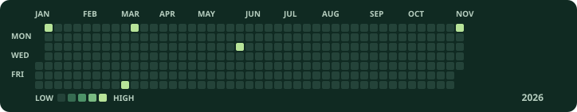

# 김재우 · Dev.peon

웹과 모바일 제품을 만들고, 운영에서 발견한 문제를 다음 개선에 반영하는 풀스택 개발자입니다.

## 기여 잔디

<picture>
  <source media="(prefers-reduced-motion: reduce)" srcset="./assets/contributions-2026-static.svg">
  
</picture>

공개 프로필의 2026.11.05 기준 스냅샷

## 프로젝트

<strong>누잼</strong> · 손끝으로 잠깐 쉬는 감각 놀이 앱

왁뿌볼을 누르거나 키보드 키링을 두드리며, 목표 없이 잠깐 손을 움직일 수 있는 모바일 앱입니다. 기획부터 디자인, 개발, 운영까지 맡았습니다.

[서비스 보기](https://www.nuzam.kr/) · [App Store에서 보기](https://apps.apple.com/kr/app/id6797218260)

## 경력

- **MNKL · Product Engineer** — 커머스 UX와 운영 자동화
- **NEUROCORE · Full-stack Developer** — 고객사 맞춤 기능
- **UCWARE · Full-stack Developer** — 교육 서비스 개발·운영 및 고객사 납품 솔루션 유지보수

## 기술

- **웹 프론트엔드** · React, Next.js
- **백엔드** · Node.js, NestJS, Java, Spring, JSP
- **모바일** · React Native

[ta3844@naver.com](mailto:ta3844@naver.com)
