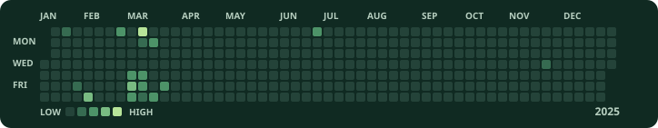
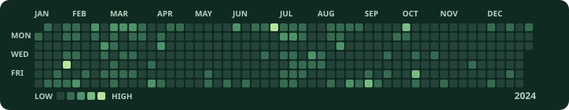
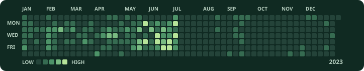

# 김재우 · Dev.peon

웹과 모바일 제품을 만들고, 운영에서 발견한 문제를 다음 개선에 반영하는 풀스택 개발자입니다.

## 기여 잔디

공개 프로필의 2026.11.05 기준 스냅샷

## 프로젝트

제목을 누르면 만든 기능과 관련 링크를 볼 수 있습니다.

<strong>누잼</strong> · 손끝으로 잠깐 쉬는 감각 놀이 앱

왁뿌볼을 누르거나 키보드 키링을 두드리며, 목표 없이 잠깐 손을 움직일 수 있는 모바일 앱입니다. 기획부터 디자인, 개발, 운영까지 맡았습니다.

[서비스 보기](https://www.nuzam.kr/) · [App Store에서 보기](https://apps.apple.com/kr/app/id6797218260)

<strong>챙겨가</strong> · 집을 나서기 전 준비물을 확인하는 iPhone 앱

외출 목록을 앱과 홈·잠금 화면 위젯에서 확인할 수 있게 설계했습니다. 집을 벗어날 때 준비물 확인을 알리고, 목록과 위치 데이터는 기기 안에서 처리합니다.

[포트폴리오에서 화면 보기](https://devpeon.ai.kr/about#services)

<strong>Devpeon</strong> · AI와 개발을 기록하는 기술 블로그

오픈소스 코드와 원문 자료를 직접 읽고, 구현에서 얻은 판단 기준을 정리합니다. Next.js와 Markdown으로 글을 관리하고 정적 페이지로 제공하는 블로그를 직접 만들었습니다.

[글 목록 보기](https://devpeon.ai.kr/#notes)

## 경력

- **MNKL · Product Engineer** — 커머스 UX와 운영 자동화
- **NEUROCORE · Full-stack Developer** — 고객사 맞춤 기능
- **UCWARE · Full-stack Developer** — 교육 서비스 개발·운영

## 기술

- **웹 프론트엔드** · React, Next.js
- **백엔드** · Node.js, NestJS, Java, Spring, JSP
- **모바일** · React Native

[ta3844@naver.com](mailto:ta3844@naver.com)
